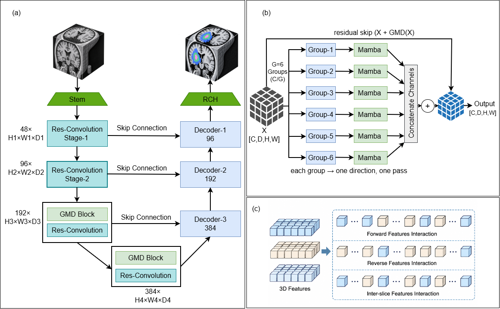

# GMD-Mamba: Lightweight 3D Medical Image Segmentation Using a Grouped Multi-Directional Mamba

Official implementation of **GMD-Mamba**, a lightweight (~19.2M parameter) 3D
medical image segmentation network. GMD-Mamba pairs a SegResNet-style residual
U-Net with a **Grouped Multi-Directional (GMD)** state-space mixer applied only
at the deepest stages. The GMD scan obtains multi-directional 3D context in a
single pass by splitting the channels into *G* groups and scanning each group
along a different axis order, reducing the projection cost of multi-directional
scanning from *O(K·C²)* to *O(C²/G)* — with no structure-tensor computation,
eigen-decomposition, or learned direction selection.

<p align="center">
  
  <br>
  <em>Overview of GMD-Mamba: (a) overall architecture, (b) the GMD block,
  (c) voxel-to-sequence flattening for one group.</em>
</p>

## Highlights

- **Lightweight:** ~19.2M parameters (≈7× fewer than SegMamba-V2's 138.8M).
- **Single-pass multi-directional scanning** via channel grouping — *O(C²/G)* cost.
- **Deep-only placement:** Mamba processes at most 16³ = 4096 tokens per scan.
- Competitive accuracy on **BraTS2023** and **MSD Spleen** at a fraction of the
  parameters of CNN, Transformer, and Mamba baselines.

## Results

### BraTS2023 (SegMamba-V2 partition & protocol, region-wise Dice / HD95)

| Method | Params (M) | Avg Dice (%) | Avg HD95 (mm) |
|---|---|---|---|
| SegMamba | 67.4 | 91.32 | 3.56 |
| SegMamba-V2 | 138.8 | 91.60 | 3.23 |
| **GMD-Mamba (ours)** | **19.2** | **92.00** | **2.70** |

Full per-region (WT/TC/ET) numbers and all baselines are in the paper.

### Ablation (BraTS2023, 400-epoch schedule, region-wise avg Dice)

| Configuration | Params (M) | Dice (%) |
|---|---|---|
| Backbone, no Mamba | 19.10 | 91.31 |
| + Bidirectional scan (deep) | 19.65 | 91.17 |
| + Full-width multi-directional scan (deep) | 19.68 | 90.98 |
| + GMD scan (shallow + deep) | 19.24 | 89.85 |
| **+ GMD scan (deep) [ours]** | **19.23** | **91.47** |

### MSD Spleen (controlled, same pipeline)

| Method | Params (M) | Dice (%) |
|---|---|---|
| SegResNet (backbone) | 18.8 | 79.4 |
| **GMD-Mamba (ours)** | **19.2** | **91.9** |

## Repository structure

```
GMD-Mamba/
├── model/
│   └── resmamba_model.py        # GMD-Mamba model (class ResMamba3D; GMD scan = GMDMamba3D)
├── scripts/
│   ├── segv2_repro_resmamba_reznor.py  # BraTS training (SegMamba-V2 recipe)
│   ├── eval_resmamba_regionwise.py     # region-wise WT/TC/ET Dice + HD95 eval
│   ├── ablation_params.py              # parameter counts for ablation variants
│   ├── make_brats_figure.py            # qualitative BraTS panels
│   └── make_spleen_figure.py           # qualitative spleen panels
├── figures/
│   └── Sys_Model.png            # architecture figure (add your file here)
├── requirements.txt
└── README.md
```

## Installation

```bash
conda create -n gmdmamba python=3.10 -y
conda activate gmdmamba
pip install -r requirements.txt
# Mamba kernels (CUDA GPU required):
pip install causal-conv1d mamba-ssm
```

> Mamba requires a CUDA GPU. On clusters where `mamba-ssm` cannot be compiled,
> install matching prebuilt wheels for your CUDA/torch versions.

## Usage

```python
import torch
from model.resmamba_model import ResMamba3D   # GMD-Mamba

# BraTS: 4 input modalities, 4-class softmax
model = ResMamba3D(in_channels=4, num_classes=4, init_filters=32,
                   scan="grouped", mamba_stages=(2, 3)).cuda()

x = torch.randn(1, 4, 128, 128, 128, device="cuda")
y = model(x)          # (1, 4, 128, 128, 128)
print(sum(p.numel() for p in model.parameters()) / 1e6, "M params")
```

`scan` options: `grouped` (GMD, ours), `bidir` (bidirectional), `grouped_gated`
(GMD + fusion gate). `mamba_stages` selects which encoder stages use the mixer
(`(2,3)` = the two deepest; `()` = pure convolutional backbone).

## Datasets

- **BraTS2023 (GLI):** https://www.synapse.org/brats2023
- **MSD Spleen (Task09):** http://medicaldecathlon.com

## Citation

```bibtex
@inproceedings{ullah2026gmdmamba,
  title     = {GMD-Mamba: Lightweight 3D Medical Image Segmentation Using a Grouped Multi-Directional Mamba},
  author    = {Ullah, Rahim and Abbas, Hassan and Nabi, Syed Waqar},
  booktitle = {Proc. IEEE Int. Symp. Biomed. Imag. (ISBI)},
  year      = {2026}
}
```

## Acknowledgments

Built on the [SegMamba](https://github.com/ge-xing/SegMamba) `light_training`
framework and [MONAI](https://monai.io). We thank the authors of SegMamba /
SegMamba-V2 for their public code and protocols.
